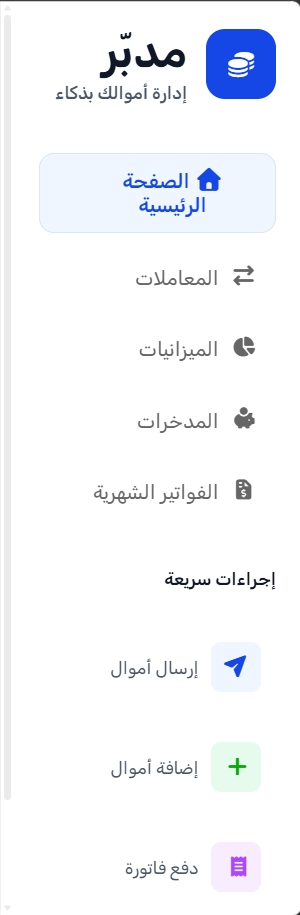
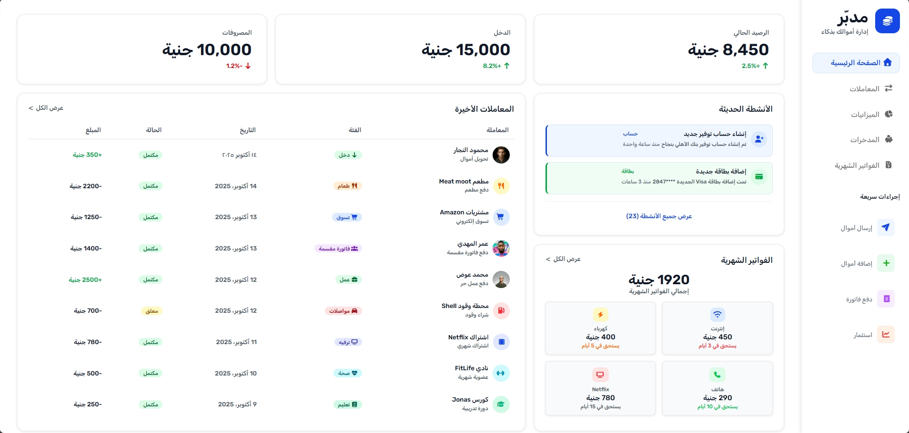
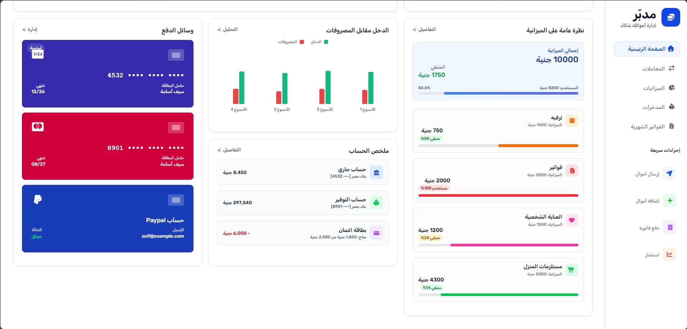

# Mudabbir 💰

A personal finance dashboard designed to help users manage, track, and understand their finances in one organized interface.

## Overview

Mudabbir is a personal finance management dashboard designed to help users take control of their monthly finances.

The dashboard provides an organized overview of income, expenses, balances, bills, budgets, transactions, payment methods, and accounts, making it easier to monitor spending and make better financial decisions.

The interface is designed in Arabic and uses a clean RTL layout to provide a natural experience for Arabic-speaking users.

## Features

- Arabic RTL interface
- Responsive dashboard layout
- Sidebar navigation with expand/collapse toggle
- Header with profile and notifications
- Financial summary cards
- Recent activities and transactions
- Monthly bills tracker
- Budget overview
- Income vs. expenses chart
- Payment methods management
- Account summary
- Responsive layout for different screen sizes
- CSS Grid-based dashboard structure

## Technologies

- HTML5
- CSS3

## Layout & Styling

The dashboard layout is built using CSS Grid to organize the main sections and create a structured financial management interface.

Custom CSS is used to control the visual design, spacing, typography, colors, cards, progress indicators, and other interface elements.

CSS media queries are used to adapt the dashboard layout to different screen sizes.

## RTL & Arabic Interface

Mudabbir is designed as an Arabic-first interface with a right-to-left (RTL) layout.

The RTL structure makes the navigation, financial information, and dashboard components easier to use for Arabic-speaking users.

## Dashboard Sections

### Sidebar Navigation

A dedicated sidebar provides navigation between the different financial tools and reports available in the dashboard.


### Header / Top Bar

The top bar contains:

- Mudabbir logo
- User profile
- Notifications
- Financial alerts

This section provides quick access to important information and upcoming financial events.


### Financial Summary

The dashboard provides three key financial metrics:

- Current Balance
- Monthly Income
- Expenses

The summary cards provide a quick overview of the user's current financial situation.


### Recent Activities & Transactions

A detailed transaction section displays recent financial activities and helps users understand where their money is being spent.

Examples include:

- Coffee purchases
- Grocery expenses
- Online subscriptions
- Other transactions

### Monthly Bills

The bills tracker displays upcoming payments along with their due dates and amounts.

This helps users keep track of recurring payments and plan their expenses.

### Budget Overview

The budget section allows users to monitor spending across different categories such as:

- Food
- Entertainment
- Transport

Progress indicators provide a visual representation of how much of each budget has been used.

### Income vs. Expenses

A visual chart compares income and expenses over time.

This helps users identify spending patterns and understand their financial performance throughout the month.

### Payment Methods

The payment methods section provides an organized view of cards and payment accounts.

Users can track their different payment methods and monitor relevant information such as card usage and limits.

### Account Summary

The account summary provides an overview of different financial accounts, including:

- Checking accounts
- Savings accounts
- Credit cards

Each account can display its current balance and relevant limits.

## Responsive Design

The dashboard uses CSS media queries to adapt the layout to different screen sizes.

The interface is designed to remain organized and usable across desktop, tablet, and mobile devices.

## Advanced CSS

The interface also demonstrates advanced CSS techniques for creating interactive visual elements.

The payment cards can use 3D transformation effects to create an interactive card-flip experience, revealing additional information on the back of the card.

This effect can be implemented using CSS properties such as:

- `transform`
- `perspective`
- `backface-visibility`
- 3D rotations

## Project Structure

```text
Mudabbir/
│
├── css/
│   ├── all.min.css
│   ├── main.css
│   ├── media_style.css
│
├── images/
│   ├── images of projects
│
├── screenshots/
│   ├── screenshots of projects
│
├── webfonts/
│   ├── fonts of projects
│
├── index.html
│
└── README.md
